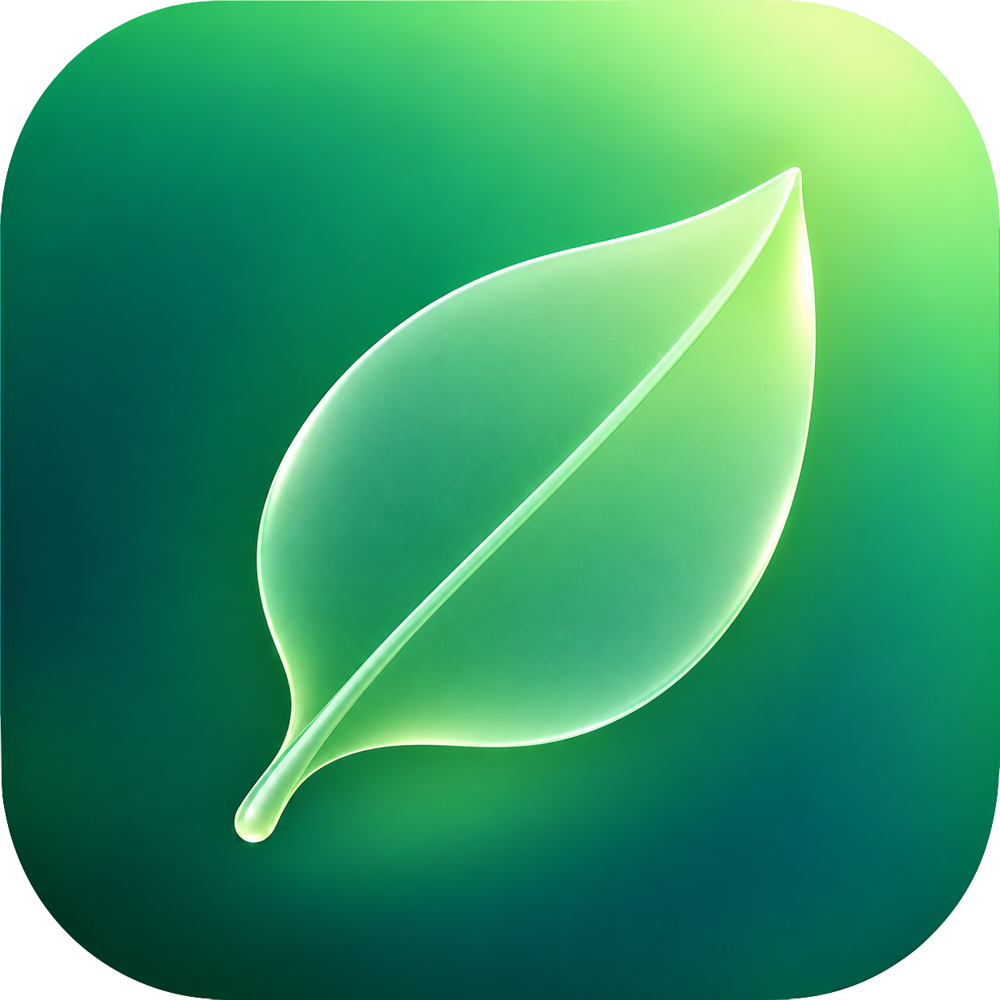
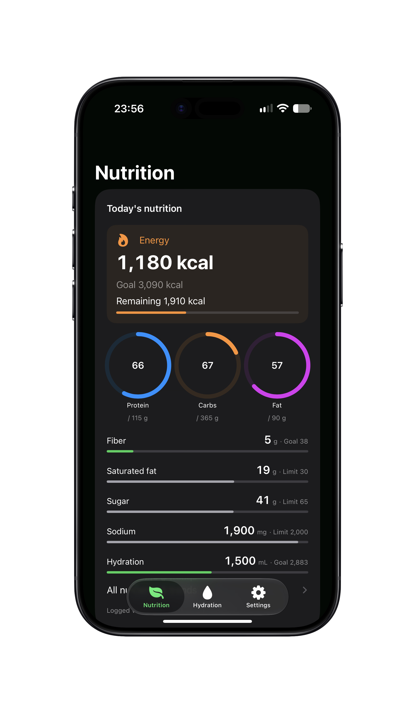
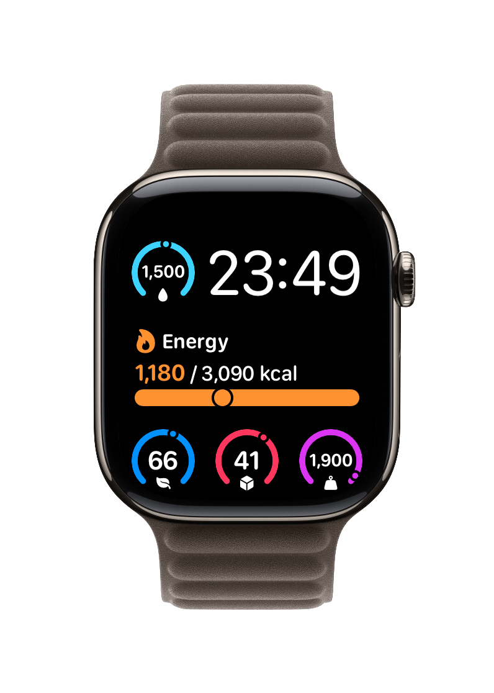
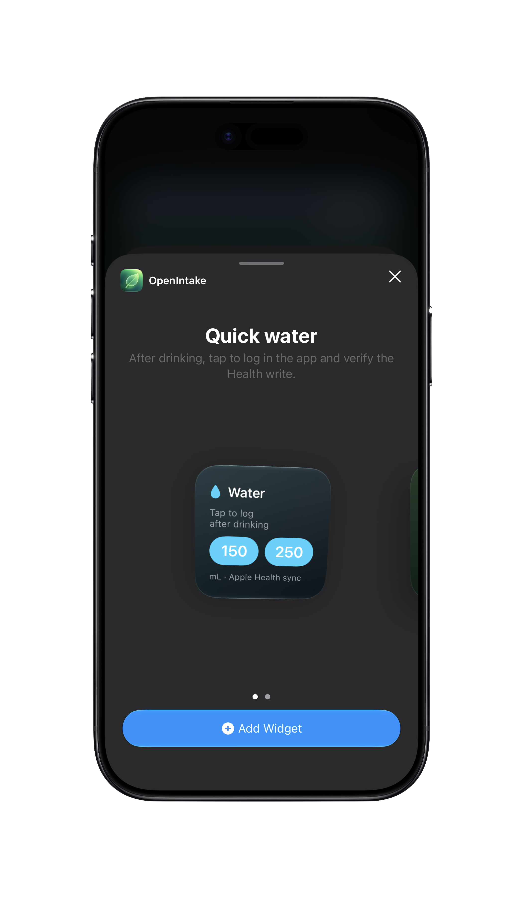
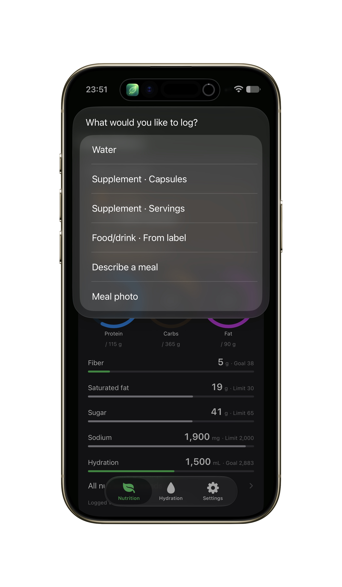
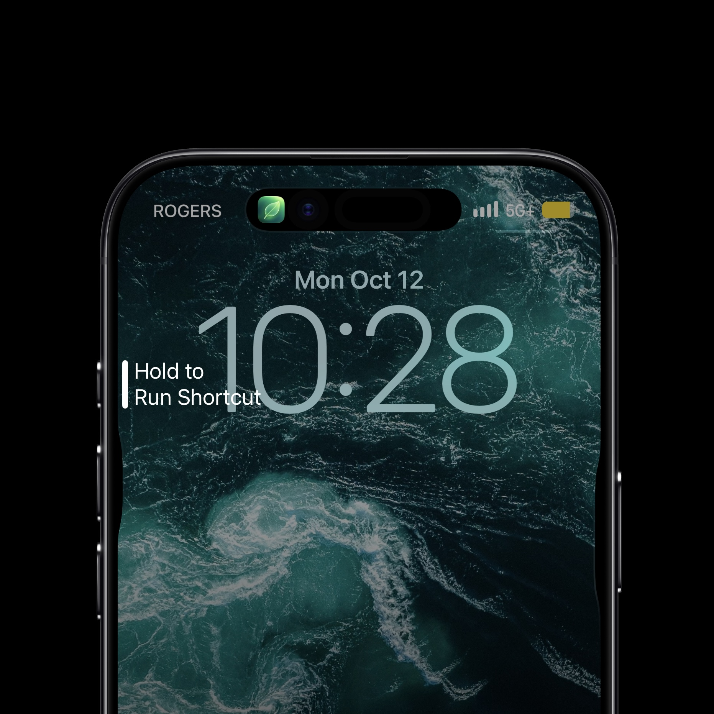

<h1 align="center">
   OpenIntake
</h1>

[English](README.md) · [简体中文](README.zh-CN.md) · [Releases](https://github.com/Eason556-dev/openintake/releases)

**A small, local-first intake logger for iPhone and Apple Watch, built around Apple Health.**

Create a product once, enter what you actually consumed, and sync supported, known nutrition values to Apple Health. OpenIntake has no account, developer server, paid API or built-in AI.

**Local-first · Privacy-first · Zero Server · Zero Account · Open Source**

Current source preview: **0.8.0 / build 20**. [Release notes](docs/releases/v0.8.0.md) · MIT license.

## Vision

Devices already collect activity and vital signs well. Food, drinks and supplements still need a convenient way into Apple Health. OpenIntake focuses on that missing input step: reusable local product records, explicit quantities, deterministic calculations and verifiable synchronization.

Apple Health remains the center for supported health data. OpenIntake does not diagnose, recommend doses or predict every food's nutrition. You decide what to record; unknown values remain unknown.

## On iPhone and Apple Watch

<p align="center">
  
  &nbsp;&nbsp;
  
</p>

<p align="center"><strong>Your daily intake, at a glance.</strong><br>Review nutrition on iPhone. Check it on your wrist. Clear values, personal targets and limits.</p>

### Start wherever it feels natural

<p align="center">
  
  &nbsp;&nbsp;
  
</p>

<p align="center"><strong>Tap a widget. Run a shortcut.</strong><br>One familiar entry point for water, supplements, food and meals you actually consumed.</p>

<p align="center">
  
</p>

<p align="center">Assign the shortcut to the Action Button on a supported iPhone to start logging.</p>

<details>
<summary>About these images and Markdown layout</summary>

Maintainer-provided real-device views show the state at capture time; device frames are part of the supplied artwork. Location, capture-device and other identifying metadata have been removed without changing the interface content.

For a normal image, use ``. The title icon and side-by-side images use GitHub-supported HTML `` elements with a `width` attribute. All images use repository-relative paths and remain available in forks and source downloads.

</details>

## Features

| Area | Current behavior |
| --- | --- |
| Products | Save and reuse supplement, food and drink labels. Enter serving definitions, units and known amounts. Edit templates without rewriting old intake snapshots. |
| Basic OCR | Use the document camera and Apple Vision to transcribe supplement labels. Offline rules assist with names, values and relationships; review every result. No model is called. |
| Meals | Match offline food references or paste explicit nutrient summaries. Record energy alone, scale per-100 g/mL values, retain manual total adjustments and save reusable meals. Unknowns stay unknown; legacy meals can recover missing fields before resync. |
| Water | Quick/custom mL logging, a daily ring, a personal goal and optional local reminders. |
| Nutrition | Label-based sugar, sodium, energy, macro- and micronutrients; 39 dietary HealthKit quantity types. An approximate ordinary-salt conversion is explicitly marked as a manual estimate. |
| Ingredient relationships | Retain unsupported ingredients locally. Do not add extract equivalents or already-included subcomponents to totals. Broad omega-3 → polyunsaturated-fat mapping requires explicit consent. |
| Sync | Persist first, check each write permission, save and verify corresponding HealthKit samples. Keep failures for retry. Local totals and authorization completion do not prove sync. |
| History | Inspect intake and sources; swipe to undo and restore accidental undo. Event IDs and frozen write plans protect retries and history. |
| Watch | View today's values/goals and log water or products configured on iPhone. Automatic delivery uses stable request IDs and the iPhone HealthKit writer. New product setup stays on iPhone. |
| System actions | iPhone widgets, Watch complications, App Intents, Siri/Shortcuts and Action Button workflows use the same recording path. System timing and connectivity affect background delivery. |
| Languages | English/Chinese app UI, selectable in Settings → Language. Standardized ingredient names follow this setting; user names and label evidence retain their original language. |
| Optional external tools | Share a generic checking prompt with a tool you choose, such as ChatGPT or Claude. No automatic data transfer, provider SDK, account or API key integration. Paste the meal nutrient code block and review it; template zero placeholders must be confirmed or marked unknown. |

**Scanning/saving a product is not intake.** Medication doses never map to nutrition. Unknown nutrients never become zero. Photos are temporary meal-entry references, not a nutrition estimator.

## Download the Xcode source

1. Open [Releases](https://github.com/Eason556-dev/openintake/releases) and select the version you want.
2. In **Assets**, download `OpenIntake-0.8.0-source.zip` and its `.sha256` file for this release. GitHub's automatic **Source code (zip)** is also available, but the named asset includes a source manifest and has passed the packaging audit.
3. Optionally verify the download in Terminal from its folder:
   ```sh
   shasum -a 256 -c OpenIntake-0.8.0-source.zip.sha256
   ```
4. Double-click the ZIP to extract. Open the extracted folder, then **OpenIntake.xcodeproj**.
5. Follow the [step-by-step iPhone and Watch build guide](docs/BUILD.en.md).

This download is **unsigned development source**, not an IPA or an App Store installer. Each builder uses their own Apple account, signing team, unique identifiers and device authorization. Do not install another person's signing profiles.

## Quick build path

You need a Mac supported by your Xcode, Xcode with the required iOS/watchOS SDKs, and Python 3 for repository scripts. This release was tested with **Xcode 27.2 (27B52)**. Deployment targets are iOS 17 and watchOS 10; new system features use availability checks. Older Xcode versions are not certified by this release. [Apple's current Xcode requirements](https://developer.apple.com/xcode/system-requirements/).

1. Copy `Config/Local.example.xcconfig` to **Config/Local.xcconfig**. If a local file already exists, edit it instead of replacing it.
2. Replace the sample bundle prefix and App Group with your own unique values. All four targets and the Watch companion reference derive from the bundle prefix.
3. In Xcode → Settings → Accounts, add your own Apple account. For **all four targets**, enable automatic signing, select the same Team and configure the matching App Group. Keep HealthKit on the iPhone target.
4. Connect/trust the iPhone, enable Developer Mode, choose the **OpenIntake** scheme and your ready iPhone, then press **⌘R**.
5. In the app, allow the nutrition types you intend to write. Save a product, then record actual intake and inspect the sync status and Apple Health samples.
6. For the Watch, pair it with that iPhone, enable its Developer Mode if required by Xcode, choose **OpenIntakeWatch** and the ready Watch, then **⌘R**.

Full signing requires a Team/provisioning profile that supports the included **HealthKit and App Groups** capabilities. Availability depends on Apple membership; a free Personal Team is not guaranteed to support this complete target set. If Xcode reports an unsupported capability, use an eligible team or inspect the UI in Simulator; do not remove HealthKit and claim sync works. [Apple capability reference](https://developer.apple.com/help/account/reference/supported-capabilities-ios).

See [BUILD.en.md](docs/BUILD.en.md) for all four identifiers, simulator instructions, device installation, permissions, troubleshooting and an acceptance checklist.

## Meal recording without AI

Enter `200g cooked rice and 150g cooked beef`, select the actual preparation and review the offline reference. Or paste explicit whole-meal nutrient values:

```text
Meal: Example lunch
Dietary Energy: 650 kcal
Protein: 32 g
Carbohydrates: 70 g
Total Fat: 20 g
Sodium: 900 mg
```

Tap **Organize meal text**, review the filled fields and adjust totals if needed. Confirmation sends known values through the same HealthKit outbox. Energy-only records do not require invented food weights. Editing or completing a previous meal preserves its timestamp and event ID.

- Leave unknown nutrients blank; unknown-only meal records remain local.
- Confirm actual zeros or mark external-template zero placeholders unknown in one action.
- Unclear quantities, incompatible units, duplicate submissions and stale text produce specific blocking reasons instead of bypassing validation.

[Meal/dashboard repair notes](docs/DASHBOARD_NUTRIENT_REPAIR.md) · [Offline reference and limits](docs/OFFLINE_NUTRITION_REDESIGN.md)

## Privacy and data boundaries

Data stays on the device and in the authorized Apple Health store. WatchConnectivity and App Groups provide Apple-device/extension communication; no developer server is required. There are no telemetry, advertising or mandatory model SDKs. Notifications are local.

Original label text and sources are kept for review. Historic AI estimates retain their origin for compatibility; no current feature calls a model. HealthKit-supported values use the shared outbox; local-only ingredients and meals stay visibly local.

Personal `Config/Local.xcconfig`, Apple IDs, signing certificates/profiles, API keys, developer build output and personal health exports are excluded from source releases. [Privacy design](docs/PRIVACY.md) · [Security](SECURITY.md).

## Tests and source packaging

```sh
swift test
python3 scripts/check_public_files.py
python3 scripts/check_localization.py
python3 scripts/generate_project.py
xcodebuild -project OpenIntake.xcodeproj -scheme OpenIntake \
  -destination 'generic/platform=iOS' -derivedDataPath /tmp/OpenIntake-build \
  CODE_SIGNING_ALLOWED=NO build
python3 scripts/package_source.py --version 0.8.0
```

If command-line tools select the wrong Xcode, prefix commands with `DEVELOPER_DIR=/Applications/Xcode.app/Contents/Developer`. No signing is needed for the unsigned build. Device installation and real HealthKit acceptance are separate steps.

219 core tests passed for this release, including manual recording, unknown-only local meals, frozen snapshots, permissions, failures, retries, undo/restore and Watch request deduplication. See [meal fix and validation](docs/MEAL_MANUAL_RECORDING.md). Mock tests and simulator screenshots do not prove physical-device synchronization.

The source ZIP includes `SOURCE_MANIFEST.json` with per-file SHA-256 values. The release workflow checks, builds and packages source on a `v*` tag and publishes a prerelease. [Maintainer publishing steps](docs/PUBLISHING.md).

## Structure and contributing

```text
App/                     iPhone UI and Apple adapters
WatchApp/                Watch UI and request outbox
Widgets/  WatchWidgets/  iPhone widgets and Watch complications
Shared/                  Localization and cross-device models
Sources/IntakeCore/       Rules, calculations, validation, persistence and sync
Tests/                   Synthetic regression fixtures and tests
Config/                  Public defaults + ignored personal override
scripts/                 Project generation, audits and source packaging
docs/                    Build guides, design, screenshots and release notes
```

Forks and contributions are welcome under [MIT](LICENSE). See [CONTRIBUTING.md](CONTRIBUTING.md). Keep new intake types on the shared HealthKit outbox; preserve permission, sample verification, retry, undo and idempotency tests. Never commit personal health data or signing credentials.

Current limits: the offline food reference is historical USDA SR Legacy with limited Chinese aliases; there is no complete branded barcode catalog, automatic nutrition prediction, medication management or universally installable IPA. OCR and background synchronization need device acceptance. The project is a developer preview and does not provide medical advice.

### Offline food reference and nutrition dashboard

Meal entry now supports deterministic English/Chinese food matching with a bundled USDA SR Legacy reference (7,793 foods), structured food/serving selection, per-nutrient completeness, retained manual overrides, reusable meals, and recoverable HealthKit edits. The dashboard adds energy, macro rings, essential nutrient/limit bars, all-nutrient detail and trends. No AI, server, API key or account is required. Ambiguous foods require selection; missing nutrition remains unknown. See [implementation, sources, limitations and device acceptance](docs/OFFLINE_NUTRITION_REDESIGN.md).
