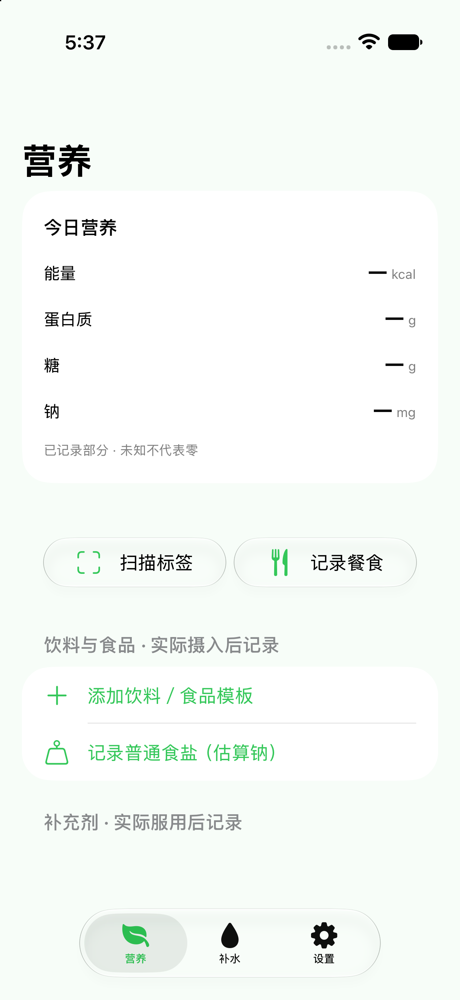
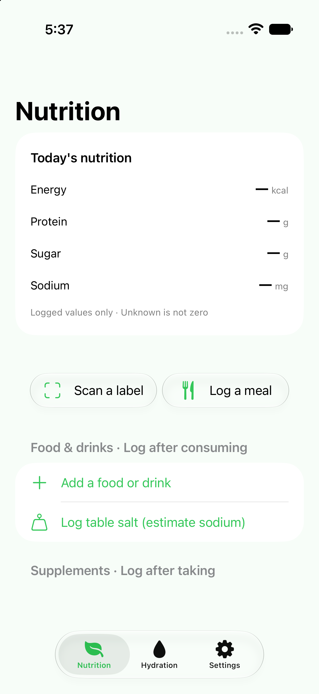
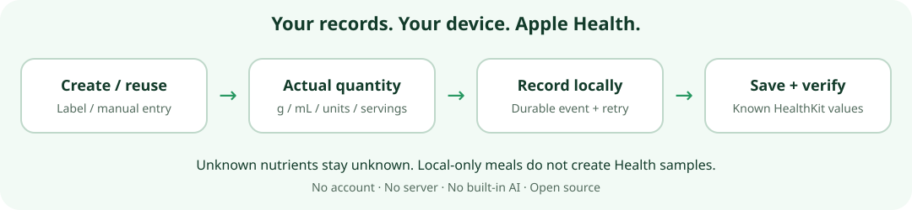
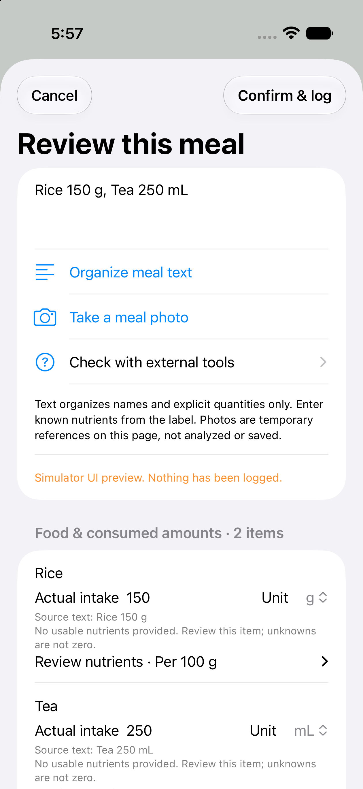

# OpenIntake

[English](README.md) · [简体中文](README.zh-CN.md) · [下载 Releases](https://github.com/Eason556-dev/openintake/releases)

**轻量的 iPhone 与 Apple Watch 摄入记录工具，以 Apple Health 为健康数据中心。**

产品资料填写一次，日常只记录实际摄入数量；有明确依据、受支持的营养值通过 HealthKit 写入并核验。无需账号、开发者服务器、付费 API 或内置 AI。

**Local-first · Privacy-first · Zero Server · Zero Account · Open Source**

当前源码预览版：**0.7.2 / build 19**。[更新说明](docs/releases/v0.7.2.md) · MIT 开源许可。

## 我们的愿景

Apple Watch 和 iPhone 已能自动采集许多运动及生理数据，食品、饮料和补充剂摄入却仍需要方便的记录入口。OpenIntake 专注补齐这一步：本地产品复用、明确的实际数量、确定性计算，以及能够核验的 Apple Health 同步。

Apple Health 继续负责受支持健康数据的集中保存。OpenIntake 不自行开发健康评分、不推荐服用剂量，也不声称能预测所有食品的营养组成。用户决定记录什么，未知值始终保持未知。

## 功能展示

<table><tr><th>中文营养首页</th><th>英文营养首页</th></tr><tr><td></td><td></td></tr></table>

以上是空资料库的真实模拟器截图，不代表真实 HealthKit 写入。未知显示 **—**；有已知值和个人目标时显示紧凑进度条。糖、钠表示已用限量，不以“摄入越多”为奖励。



## 已有功能

| 类别 | 当前能力 |
| --- | --- |
| 产品资料 | 保存并复用补充剂、食品及饮料标签，填写每份定义、单位和已知含量。编辑模板不重写历史事件快照。 |
| 基础 OCR | 文档相机与 Apple Vision 辅助抄录补充剂标签，本地规则辅助解析成分、数值和关系；需要用户逐项核对，不调用模型。 |
| 餐食记录 | 输入名称与明确的 g/mL 份量，或手动添加条目。点击记录即确认，不再需要独立开关；营养全未知也能保存本机事件。填写已知的每 100 g/mL 营养后可同步对应值。 |
| 补水 | 常用或自定义毫升数、当日圆环、个人目标及可选本机提醒。 |
| 营养 | 按标签记录糖、钠、能量及宏量/微量营养素，适配 39 种 HealthKit 饮食营养类型。普通食盐的近似钠换算明确标为人工估算。 |
| 成分关系 | 不支持的成分保留本地；提取物当量与已包含子成分不重复累计。Omega-3 → 多不饱和脂肪的宽泛映射需要明确同意。 |
| 健康同步 | 事件先持久化，再检查逐类型写入权限、保存并核验 HealthKit 样本；失败保留重试。本机统计和授权完成不代表同步成功。 |
| 记录管理 | 查看摄入、来源和状态；左滑撤销，误撤销可恢复。稳定事件 ID 和冻结写入清单保护重试与历史。 |
| Apple Watch | 显示当日数值及目标，记录饮水或 iPhone 已配置产品。自动传输使用稳定请求 ID，并由 iPhone 统一写入健康；新产品仍在 iPhone 设置。 |
| 系统入口 | iPhone 小组件、Watch 表盘组件、App Intents、Siri/快捷指令和操作按钮共用原有记录路径。后台传输受系统调度与连接影响。 |
| 中英文 | 可跟随系统，或在设置 → 语言中指定。标准化成分名称跟随 App 语言；用户名称及包装证据保持原文。 |
| 可选外部工具 | 分享通用核对提示词给自己选择的工具，如 ChatGPT、Claude；不自动发送资料、不接入提供方 SDK、账号或 API Key。核对回答后手动填写。 |

**扫描或保存产品不代表摄入。** 药品剂量不映射为营养，未知值不填零。餐食照片只在草稿页临时辅助核对，不用于营养预测。

## 从 Release 下载 Xcode 源码

1. 打开仓库的 [Releases](https://github.com/Eason556-dev/openintake/releases)，选择需要的版本。
2. 在 **Assets** 下载本版 `OpenIntake-0.7.2-source.zip` 及对应 `.sha256` 文件。GitHub 自动生成的 **Source code (zip)** 也能下载；项目命名的资产额外包含源码清单，并经过打包检查。
3. 可在下载目录打开终端验证：
   ```sh
   shasum -a 256 -c OpenIntake-0.7.2-source.zip.sha256
   ```
4. 双击 ZIP 解压，进入文件夹，打开 **OpenIntake.xcodeproj**。
5. 按[中文构建与真机安装教程](docs/BUILD.zh-CN.md)配置自己的签名并运行。

下载内容是**未签名开发源码**，不是 IPA 或 App Store 安装包。每位用户需使用自己的 Apple 账号、签名团队、唯一标识符与设备授权；不要安装其他人的签名描述文件。

## 自行构建的最短路径

需要满足所用 Xcode 要求的 Mac、含 iOS/watchOS SDK 的 Xcode，以及用于仓库脚本的 Python 3。本版使用 **Xcode 27.2（27B52）** 验证。部署目标为 iOS 17、watchOS 10，新系统功能有可用性判断；本版未认证旧 Xcode。见 [Apple 当前系统要求](https://developer.apple.com/xcode/system-requirements/)。

1. 将 `Config/Local.example.xcconfig` 复制为 **Config/Local.xcconfig**。已有本地文件时请编辑，不要覆盖。
2. 把示例 Bundle 前缀和 App Group 改成自己的唯一值。四个目标与 Watch 配套引用从同一前缀派生。
3. Xcode → Settings → Accounts 添加自己的 Apple 账号；**四个目标**选择相同 Team、自动签名并配置相同 App Group。iPhone 目标保留 HealthKit。
4. 连接并信任 iPhone，开启 Developer Mode；选择 **OpenIntake** scheme 和 Ready 的 iPhone，按 **⌘R**。
5. 在 App 中允许需要的营养写入类型。先保存产品，再记录实际摄入，核对同步状态及 Apple Health 中的样本。
6. Watch 与该 iPhone 配对；按 Xcode 要求启用开发者模式，选择 **OpenIntakeWatch** scheme 及 Ready 的 Watch，按 **⌘R**。

完整签名需要支持 **HealthKit 与 App Groups** 的 Team/描述文件。能力取决于 Apple 会员资格；不能保证免费 Personal Team 支持这套完整目标。如果 Xcode 报能力不支持，请使用符合条件的团队或先在模拟器查看 UI，不要删除 HealthKit 后宣称同步正常。见 [Apple 官方能力表](https://developer.apple.com/help/account/reference/supported-capabilities-ios)。

详细的四个标识符、模拟器、真机操作、授权、故障排查及验收步骤见 [BUILD.zh-CN.md](docs/BUILD.zh-CN.md)。

## 不使用 AI 记录餐食



手动餐食页面：右上角确认并记录可用，无独立开关。图中为尚未提交的模拟器草稿，没有任何营养估算。


输入 `米饭 150 克，茶 250 毫升`，本地规则整理名称与明确份量。补齐缺失数量后点击**确认并记录**，该点击就是确认操作。

- **全部营养未知**：保存名称与份量的本机事件，不创建营养样本，不显示“已同步健康”。
- **部分营养已知**：填写有依据的每 100 g/mL 数值，只计算并同步这些已知贡献，其他营养不填零。
- 份量无效、已有营养时又修改文字但未重新核对、重复提交或正在写入，仍会显示具体原因并阻止记录。本次修复没有无条件开启按钮。

## 隐私与数据边界

资料保存在设备和用户授权的 Apple Health 中。WatchConnectivity 与 App Groups 用于 Apple 设备及扩展通信，无需开发者服务器。没有统计跟踪、广告或强制模型 SDK，提醒是本机通知。

保留原始标签及来源供检查。历史 AI 估算保留来源以兼容旧数据，当前功能不会调用模型。已知支持值统一走 outbox；本地成分和本地餐食有明确状态。

源码发布排除个人 `Config/Local.xcconfig`、Apple ID、签名证书/描述文件、API 密钥、构建产物和个人健康导出。详见[隐私设计](docs/PRIVACY.md)与[安全说明](SECURITY.md)。

## 测试与源码打包

```sh
swift test
python3 scripts/check_public_files.py
python3 scripts/check_localization.py
python3 scripts/generate_project.py
xcodebuild -project OpenIntake.xcodeproj -scheme OpenIntake \
  -destination 'generic/platform=iOS' -derivedDataPath /tmp/OpenIntake-build \
  CODE_SIGNING_ALLOWED=NO build
python3 scripts/package_source.py --version 0.7.2
```

如果终端选中了错误的开发者工具，可给命令添加 `DEVELOPER_DIR=/Applications/Xcode.app/Contents/Developer`。无签名构建无需个人签名；安装设备和真实健康写入需要另行验收。

本版 174 项核心测试通过，覆盖手动餐食、全未知本地记录、冻结快照、权限、失败/重试、撤销/恢复与 Watch 防重。见[餐食修复及验证](docs/MEAL_MANUAL_RECORDING.md)。模拟适配器与模拟器截图不能证明真机同步。

源码 ZIP 包含逐文件 SHA-256 的 `SOURCE_MANIFEST.json`。`v*` 标签触发检查、构建、源码打包及预发布流程。维护者操作见[GitHub 发布说明](docs/PUBLISHING.md)。

## 结构与贡献

```text
App/                     iPhone UI 与 Apple 系统适配
WatchApp/                Watch UI 与请求队列
Widgets/  WatchWidgets/  iPhone 小组件与表盘组件
Shared/                  本地化与跨端模型
Sources/IntakeCore/       规则、计算、校验、持久化及同步
Tests/                   合成回归样例与测试
Config/                  公开默认值与忽略的个人配置
scripts/                 工程生成、检查与源码打包
docs/                    构建教程、设计、截图和版本说明
```

欢迎按 [MIT](LICENSE) 协议 Fork 和贡献，见 [CONTRIBUTING.md](CONTRIBUTING.md)。新摄入类型必须经过共享 HealthKit outbox，保留权限、样本核验、重试、撤销和防重测试；不提交个人健康数据或签名凭据。

当前限制：没有完整食品数据库、条码商品库、自动营养预测、用药管理或通用 IPA。OCR 与后台同步仍需真机验收。项目为开发预览版，不提供医学建议。
